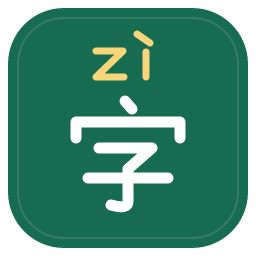

# Manggo 汉字注音

当前版本 **1.1.0**：恢复第一版的双行纯文本显示，上方带调拼音、下方中文。保留图标、离线词典、简繁体支持和自定义读音，不依赖网络或大语言模型。

## 安装与升级

在 Manggo 插件管理导入 dist/manggo-pinyin-1.1.0.mplugin，然后在翻译服务中添加或启用「汉字注音（离线）」。已安装测试版时直接更新同一插件。

旧服务保存的 Ruby / Markdown 显示配置会被自动忽略，无需手动修改。新版本不再提供这两个显示选项，不输出 HTML 标签或 Markdown 包装。

## 显示与读音

每段先显示拼音，再显示原文。窗口窄时可调小「双行显示宽度」（12–100，默认 36）。使用空格辅助对齐，比例字体下不保证每个汉字严格居中；这是兼容显示，不是真正的逐字 Ruby 注音。

英文、数字和标点保留在原文行，不转换为拼音。显示时可能按宽度换行；无汉字的选区原样返回。

采用 pinyin-pro 3.29.5 和 @pinyin-pro/data 1.3.1，整段转换后排版，相同输入和配置得到相同结果。轻声不标调；默认使用字典声调，可开启一、不的变调。未知汉字显示 ?。多音字、人名地名不能保证全部准确，可用自定义读音修正，例如 {"单田芳":"shàn tián fāng"}。单次上限 20000 个 UTF-16 字符。

## 验证结论

用户在另一台电脑实际测试：基础 Ruby 标签和 Markdown 均直接作为文本显示，因此按用户要求恢复第一版显示方式。该结论仅针对用户测试的结果显示路径，未记录 Manggo 具体版本，不代表所有版本。

自动测试在 Node.js 下进行，覆盖声调、多音词、简繁体、配置隔离、打包入口和旧设置兼容。当前环境未直接操作 Manggo。

## 开发与发布

使用 Node.js 22+，依次运行 npm ci、npm run check。构建生成图标、主插件及历史诊断包，测试通过后使用主插件。npm run preview 可生成历史 Ruby 方案与纯文本的对照预览。

源码位于 src/，图标源文件位于 assets/icon.svg，PNG 为 icon.png，构建脚本位于 scripts/。dist/、node_modules/、preview.html 不提交源码仓库。

[GitHub 上传指南](docs/PUBLISH.md)包含文件清单和命令。发布时使用 1.1.0 的主插件，不要把旧 beta 包或诊断包作为正常插件分发。

[兼容性记录](docs/COMPATIBILITY.md)保留之前的诊断方法。src/main.js 的 Ruby 辅助函数仅用于历史预览，实际 translate 入口始终返回纯文本。

## 参考

- [Manggo 官方插件指南](https://github.com/Pylogmon/manggo-plugin)
- [pinyin-pro 文档](https://pinyin-pro.cn/use/pinyin.html)

第三方许可见 THIRD-PARTY-NOTICES.txt，安装包保留原始许可。
